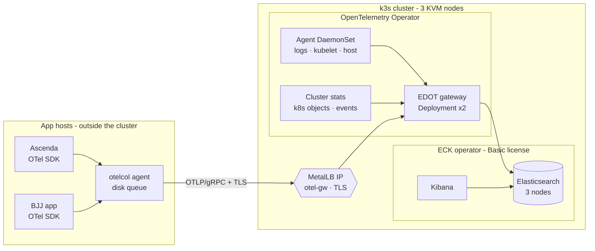

# otel-elastic-lab

[](https://github.com/danyseve/otel-elastic-lab/actions/workflows/ci.yml)
[](LICENSE)


**Vendor-neutral, full-stack observability (traces, metrics, logs) built on OpenTelemetry and
Elastic Cloud on Kubernetes (ECK), running on-prem on a highly available 3-node k3s cluster, using
only the free Basic license. Everything is defined as code and ships with scripted failure experiments.**

The lab monitors two real applications, **Ascenda** and a **BJJ (Brazilian Jiu-Jitsu) app**, which
run outside the cluster, as well as the cluster and the observability platform itself.

> 🚧 **Status:** work in progress. The code passes CI (lint/validate/render) but has not yet been deployed
> end to end; experiment results will be published in the paper as they are run.
> The previous VM-based design (Elastic installed from packages) is kept as tag
> [`v0.1.0`](https://github.com/danyseve/otel-elastic-lab/tree/v0.1.0).

> 📄 **Technical paper:** [`docs/paper.md`](docs/paper.md) (in Spanish) · 🧭 **Decisions:** [`docs/adr/`](docs/adr/)

---

## Architecture



Each k3s node is a VM on a **different physical hypervisor host**. Losing one host keeps both the
etcd quorum and the Elasticsearch quorum (2 of 3).

| Layer | Component | Notes |
|---|---|---|
| Compute | 3 × KVM VMs (16 GB each), Debian 13 + cloud-init | Terraform (`bpg/proxmox` reference implementation) |
| Kubernetes | k3s, 3 servers with embedded etcd | Installed by Ansible; MetalLB replaces the bundled LB |
| Search & UI | **ECK** → Elasticsearch 9.x (3 nodes) + Kibana | Free **Basic** license; TLS and users managed by the operator |
| Telemetry | **OpenTelemetry Operator** (`opentelemetry-kube-stack`) | Agent DaemonSet, cluster collector, EDOT gateway ×2 |
| Certificates | cert-manager with a lab CA | Kibana and OTLP gateway TLS |
| Apps | Outside the cluster, OTel SDKs → local `otelcol` agent | Persistent queue, TLS to the gateway |

## What this lab demonstrates

- **OpenTelemetry end to end.** SDKs → agents → gateway → Elasticsearch with OTel-native mapping. No vendor agents.
- **Operators over scripts.** ECK runs Elasticsearch and Kibana, and the OTel Operator runs the collectors. Everything is declarative.
- **HA with no single point of failure.** 3-node etcd and ES quorums, active/active gateways, and agents that buffer to disk.
- **The monitoring stack monitors itself.** Kubernetes, node, collector and Elasticsearch signals all go into the same backend.
- **100 % free tier.** Every feature is in the Basic license, and the paid gaps (SLOs, service maps, notification connectors) are documented with free alternatives ([ADR-0005](docs/adr/0005-basic-license-only.md)).
- **Infrastructure as code.** Terraform → Ansible (k3s) → Helmfile (platform), with no clicking.
- **Chaos experiments.** Scripted failures (a node VM down, a gateway pod killed) with measured recovery.
- **CI.** `terraform validate`, `ansible-lint` (production profile), `yamllint`, `shellcheck`, `helm lint` + `kubeconform` and `gitleaks` run on every push.

## Quickstart

### Prerequisites

- Three hypervisor hosts (reference: Proxmox VE 8+ with an API token scoped to a resource pool; no SSH
  and no `snippets` datastore needed — see [ADR-0006](docs/adr/0006-terraform-api-only.md))
- Terraform ≥ 1.6, Ansible ≥ 2.16, Helm ≥ 3.14, Helmfile ≥ 0.165, kubectl
- About 16 GB RAM and 6 vCPU free on each host

The token only needs a dedicated user, a pool and a custom role. Minimum reference setup (adjust the
pool, the storages and the SDN path to your node names):

```bash
pvesh create /pools --poolid otel-lab
pveum role add TerraformOtel --privs "VM.Allocate,VM.Audit,VM.Config.CPU,VM.Config.Memory,VM.Config.Disk,VM.Config.Network,VM.Config.Options,VM.Config.Cloudinit,VM.Config.HWType,VM.PowerMgmt,Datastore.AllocateSpace,Datastore.AllocateTemplate,Datastore.Audit,Sys.Audit,SDN.Audit,SDN.Use,Pool.Audit"
pveum user add terraform@pve
pveum user token add terraform@pve otel-lab --privsep 1 --expire 2026-12-31
for p in /pool/otel-lab /storage/local-lvm /storage/local /nodes /sdn/zones; do
  pveum acl modify "$p" --users terraform@pve --roles TerraformOtel
  pveum acl modify "$p" --tokens 'terraform@pve!otel-lab' --roles TerraformOtel
done
```

`--privsep 1` means the token permission is the intersection of user and token, so both need the ACLs.
`SDN.Audit` and `SDN.Use` are what make `bridge = "vmbr0"` work even on a host without SDN configured.

```bash
# 1. VMs (writes ansible/inventory/k3s.yml)
cp terraform/terraform.tfvars.example terraform/terraform.tfvars   # edit
make infra

# 2. k3s cluster (writes ansible/.kube/config)
make deps
cp ansible/group_vars/all/vault.yml.example ansible/group_vars/all/vault.yml
ansible-vault encrypt ansible/group_vars/all/vault.yml
make cluster

# 3. Platform: cert-manager, MetalLB, ECK, Elasticsearch, Kibana, OTel
cp k8s/values/lab.yaml.example k8s/values/lab.yaml                 # edit IPs
make platform
make status

# 4. Agents on the app hosts outside the cluster
cp ansible/inventory.example/apps.yml ansible/inventory/apps.yml   # edit
make agents
```

`agent_enabled` stays `false` on the first apply: the guest agent is installed by Ansible, so the VM
config cannot use it yet. After step 2 (`make cluster`), set `agent_enabled = true` in
`terraform/terraform.tfvars` and run `make infra` again; reboot the guests one at a time to pick it up.

Kibana: `https://kibana.<your-domain>:5601`, user `elastic`, password from `make elastic-password`.

## Repository layout

```
├── terraform/                 # 3 KVM VMs (cloud-init) + generated Ansible inventory
├── ansible/                   # OS baseline, k3s HA, OTel agent on the app hosts
├── k8s/
│   ├── helmfile.yaml.gotmpl   # cert-manager, MetalLB, ECK, lab-platform, OTel kube-stack
│   ├── charts/lab-platform/   # CA, IP pool, Elasticsearch, Kibana, collector credentials
│   └── values/                # lab values (example) + OTel collectors configuration
├── apps/                      # how to instrument Ascenda / BJJ app (per language)
├── experiments/               # k6 load test + chaos scripts
├── kibana/                    # dashboards, rules, free-tier alternatives
└── docs/                      # paper + architecture decision records
```

## Roadmap

- [x] VM-based design with Elastic from packages (tag `v0.1.0`)
- [x] ECK on k3s, OTel Operator, MetalLB, cert-manager (Basic license)
- [ ] First end-to-end deployment in the lab
- [ ] Instrument Ascenda and the BJJ app
- [ ] Dashboards and alert rules as code; ElastAlert2 for notifications
- [ ] Snapshots to S3-compatible storage (SLM)
- [ ] Polyglot demo app inside the cluster (OTel Operator auto-instrumentation)
- [ ] GitOps (Argo CD) for the platform layer
- [ ] Publish experiment results in the paper, plus an English translation

## License

[MIT](LICENSE) © danyseve. Elastic components are used under the Elastic License 2.0 (Basic tier).
