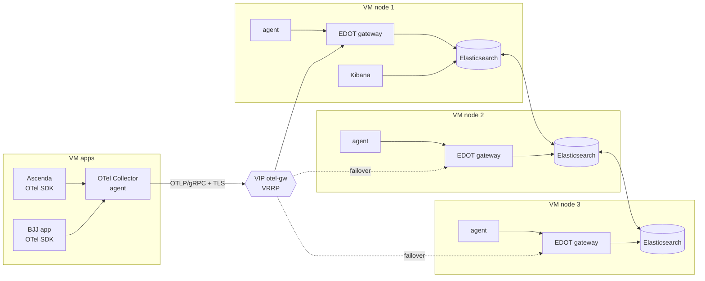

# otel-elastic-lab

[](https://github.com/danyseve/otel-elastic-lab/actions/workflows/ci.yml)
[](LICENSE)


**Vendor-neutral, full-stack observability (traces, metrics, logs) built on OpenTelemetry, with a
highly available 3-node Elasticsearch cluster on KVM virtual machines. Everything is defined as code,
can be rebuilt from scratch, and has been tested against failures.**

The lab monitors two real applications, **Ascenda** and a **BJJ (Brazilian Jiu-Jitsu) app**, as
well as the observability platform itself.

> 📄 **Technical paper:** [`docs/paper.md`](docs/paper.md) covers the design, the implementation and the
> experiment methodology (in Spanish).
> 🧭 **Architecture decisions:** [`docs/adr/`](docs/adr/)

---

## Architecture



Each Elasticsearch VM is meant to run on a **different physical hypervisor host**, so losing one
host never breaks quorum. The reference implementation targets Proxmox VE (Terraform `bpg/proxmox`),
but the Ansible layer works on any Debian 13 VM, on-prem or in the cloud.

| Layer | Component | Notes |
|---|---|---|
| Compute | 3 × ES VMs + 1 × apps VM (KVM) | `cpu=host`, virtio-scsi-single, ballooning disabled |
| OS | Debian 13 (cloud image + cloud-init) | Provisioned by Terraform |
| Storage / search | Elasticsearch 9.x, 3 master-eligible data nodes | Mutual TLS from a lab PKI managed by Ansible |
| UI | Kibana 9.x | APM / Observability, dashboards, SLOs |
| Telemetry pipeline | OTel Collector **agent** (contrib) on every VM → **EDOT gateway** on every ES node | Agents queue to disk; gateways sit behind a keepalived VIP |
| Instrumentation | OpenTelemetry SDKs and auto-instrumentation | No proprietary agents |

## What this lab demonstrates

- **OpenTelemetry end to end.** SDKs → agent → gateway → Elasticsearch with OTel-native mapping. No vendor agents.
- **Agent/gateway collector pattern.** The agent on each VM collects host metrics, journald and file logs, and Elasticsearch metrics. The gateway layer handles enrichment and APM aggregation (`elasticapm` connector).
- **HA with no single point of failure.** A 3-node ES quorum, 3 gateways behind a VRRP VIP, and persistent agent queues (`file_storage`).
- **The monitoring stack monitors itself.** Collector internal metrics, ES cluster metrics and the service logs all go into the same backend.
- **Infrastructure as code.** Terraform creates the VMs and writes the Ansible inventory, and Ansible configures everything else, including the PKI.
- **Chaos experiments.** Scripted failures (an ES node going down, the gateway failing over) with measured recovery times.
- **CI.** `terraform validate`, `ansible-lint`, `yamllint`, `shellcheck` and `gitleaks` run on every push.

## Quickstart

### Prerequisites

- Three hypervisor hosts (reference: a Proxmox VE cluster with an API token and `snippets` enabled on a storage)
- Terraform ≥ 1.6, Ansible ≥ 2.16 (`ansible-core`), and an SSH key
- About 8 GB RAM and 4 vCPU free on each host

### 1. Infrastructure (Terraform)

```bash
cd terraform
cp terraform.tfvars.example terraform.tfvars   # your endpoint, token, IPs, SSH key (git-ignored)
terraform init
terraform apply                                 # creates 4 VMs + ansible/inventory/hosts.yml
```

> Not using Proxmox? Create four Debian 13 VMs any way you like and copy
> `ansible/inventory/hosts.yml.example` to `hosts.yml`.

### 2. Configuration (Ansible)

```bash
cd ansible
ansible-galaxy collection install -r requirements.yml
cp group_vars/all/vault.yml.example group_vars/all/vault.yml
ansible-vault encrypt group_vars/all/vault.yml  # set strong passwords first
ansible-playbook site.yml --ask-vault-pass
```

### 3. Open Kibana

`https://es-01.<your-domain>:5601`. Log in as `elastic` and go to **Observability → Applications**.
Import the lab CA (`ansible/.pki/ca.crt`) into your browser if you want a green padlock.

Run `make help` to see every shortcut.

## Repository layout

```
├── terraform/            # VMs (cloud-init) + generated Ansible inventory
├── ansible/
│   ├── site.yml          # full deployment
│   └── roles/            # pki, common, elasticsearch, kibana, otel_gateway,
│                         # keepalived, otel_agent, app_instrumentation
├── apps/                 # how to instrument Ascenda / BJJ app (per language)
├── experiments/          # k6 load tests + chaos scripts
├── kibana/               # exported dashboards / SLO definitions
└── docs/
    ├── paper.md          # technical paper
    └── adr/              # architecture decision records
```

## Roadmap

- [x] Terraform: VMs from Debian 13 cloud image
- [x] Ansible: 3-node Elasticsearch with TLS, Kibana
- [x] OTel agent + EDOT gateway, keepalived VIP, persistent queues
- [x] Chaos and load experiment scripts
- [ ] Instrument Ascenda and the BJJ app (traces, metrics, logs)
- [ ] Dashboards, SLOs and alerts as code (`elastic/elasticstack` Terraform provider)
- [ ] Polyglot demo app so anyone can reproduce the lab without the private apps
- [ ] Tail-based sampling (`loadbalancing` exporter + `tail_sampling` processor)
- [ ] Publish experiment results in the paper
- [ ] English translation of the paper

## Screenshots

_Coming soon: service map, trace waterfall, host metrics and the chaos experiment timeline._

## License

[MIT](LICENSE) © danyseve
